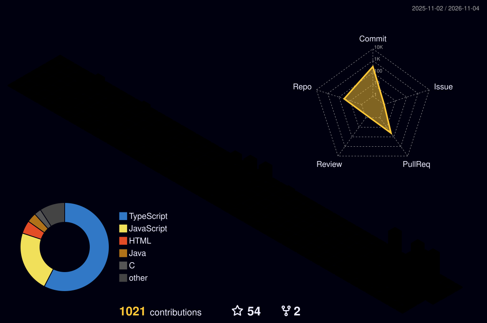

# Komi Godwin EDOH BEDI

**Développeur web** · React · Next.js · TypeScript

---

## À propos

Étudiant en 3ᵉ année de Licence Professionnelle Génie Logiciel à l'**École Polytechnique de Lomé**, au Togo.

Je développe des applications web avec **React**, **Next.js** et **TypeScript**. Mon travail se concentre sur le front-end : conception d'interfaces, performances, accessibilité et internationalisation. Je conçois également mes propres maquettes, ce qui me permet de porter un projet de l'idée à la mise en production.

Plusieurs de mes projets sont aujourd'hui déployés et utilisés en conditions réelles.

- **Expérience :** stage de 2 mois chez KofCorporation
- **En cours :** LUNA, PWA de santé menstruelle

---

## Projets

### KofCorporation — Refonte du site d'entreprise

Refonte complète du site d'une entreprise IT de Lomé, menée en autonomie dans le cadre de mon stage. Audit technique préalable (performance, SEO, accessibilité, conformité) puis reconstruction intégrale : design system clair/sombre, internationalisation FR/EN, pages de services dynamiques, animations.

`Next.js` · `TypeScript` · `Tailwind CSS` · `Framer Motion` · `next-intl` · `Vercel`

### LUNA — PWA de santé menstruelle

Application web progressive de suivi et d'information en santé menstruelle, contextualisée pour l'Afrique francophone. Prédiction de cycle, assistant conversationnel, contenus pédagogiques et annuaire de professionnels de santé. Conception appuyée sur une étude terrain de plus de 100 répondantes.

Projet en cours — Hackathon AI4Youth NEURACTIF 2026, équipe qualifiée en demi-finale.

`Next.js` · `TypeScript` · `PWA` · `IA générative`

### Now — Suivi et relance de créances

Application mobile-first de gestion des impayés : tableau de bord temps réel, scoring de risque par créance, filtres avancés et génération automatisée de messages de relance par IA.

`TypeScript` · `React` · `Tailwind CSS`

### ChainCacao — Traçabilité blockchain

MVP de traçabilité pour la filière café-cacao au Togo, conforme à la réglementation européenne EUDR 2025. Vérification de l'origine d'un lot en quelques secondes, architecture pensée pour les zones à faible connectivité.

Classé 10ᵉ en phase finale nationale du Miabé Hackathon 2026.

`React` · `Supabase` · `Solidity` · `Polygon PoS` · `ERC-721`

### AOA Togo — Site vitrine associatif

Site institutionnel de l'ONG Apprentis-Orphelins d'Afrique, avec gestion de contenu autonome via CMS headless. Réalisé bénévolement, en production depuis 2026.

`React 19` · `Tailwind CSS` · `Sanity CMS` · `Vercel`

### JAXE TECH — Site one-page

Site vitrine pour une agence digitale togolaise, réalisé sous contrainte de temps dans le cadre d'un test technique de recrutement. Focus sur le responsive, le SEO local et l'optimisation de la conversion.

`HTML` · `CSS` · `JavaScript`

---

## Autres projets

- **GoPrint** — extension Chrome d'impression · [Code](https://github.com/Godwin-creator/GoPrint)
- **PAC** — chatbot de diagnostic de panne d'alimentation · [Site](https://godwin-creator.github.io/PAC/) · [Code](https://github.com/Godwin-creator/PAC)
- **Flappy Bird V2** — jeu web avec chiffrement du score · [Jouer](https://godwin-creator.github.io/flappybird-v2/) · [Code](https://github.com/Godwin-creator/flappybird-v2)
- **E-PolyBiblio** — bibliothèque numérique de l'EPL, en conception et pas encore fonctionnelle · [Dépôt](https://github.com/Godwin-creator/E-PolyBiblio)

---

## Stack technique

**Front-end**

**Back-end & données**

**Langages & académique**

**Outils & design**

![Canva](https://img.shields.io/badge/Canva-00C4CC?style=flat-square&logo=data%3Aimage%2Fsvg%2Bxml%3Bbase64%2CPHN2ZyByb2xlPSJpbWciIHZpZXdCb3g9IjAgMCAyNCAyNCIgeG1sbnM9Imh0dHA6Ly93d3cudzMub3JnLzIwMDAvc3ZnIj48dGl0bGU%2BQ2FudmE8L3RpdGxlPjxwYXRoIGZpbGw9IiNmZmYiIGQ9Ik0xMiAwQzUuMzczIDAgMCA1LjM3MyAwIDEyczUuMzczIDEyIDEyIDEyIDEyLTUuMzczIDEyLTEyUzE4LjYyNyAwIDEyIDB6TTYuOTYyIDcuNjhjLjc1NCAwIDEuMzM3LjU0OSAxLjQwNSAxLjIuMDY5LjU4My0uMTcxIDEuMDk3LS44MjIgMS40MDYtLjM0My4xNzEtLjQ4LjE3Mi0uNTQ5LjA2OS0uMDM0LS4wNjkgMC0uMTM3LjA2OS0uMjA2LjYxNy0uNTE0LjYxNy0uOTI2LjU0OC0xLjUwOC0uMDM0LS4zNzgtLjMwOC0uNjE4LS41ODMtLjYxOC0xLjIgMC0yLjkxNCAyLjY3NC0yLjY3NCA0LjYyOS4xMDMuNzU0LjU0OSAxLjY0NiAxLjUwOSAxLjY0Ni4zMDggMCAuNjUtLjEwMy45Ni0uMjQuNS0uMjY0Ljc5OS0uNDcgMS4wOTctLjgtLjA3My0uODg1LjcwNC0yLjA0NiAxLjg1MS0yLjA0Ni41MTUgMCAuOTI2LjIwNS45Ni41ODMuMDY4LjUxNC0uMzc3LjU4Mi0uNTE0LjU4MnMtLjM3OC0uMDM0LS4zNzgtLjE3Yy0uMDM0LS4xMzguMzA5LS4wNy4yNzUtLjM3OC0uMDM1LS4yMDYtLjI0LS4yNzQtLjQ0Ni0uMjc0LS43MiAwLTEuMTMxLjk5NC0xLjAyOSAxLjYxMS4wMzUuMjc1LjE3Mi41NDkuNDQ3LjU0OS4yMDUgMCAuNTE0LS4zMS42MTctLjc1NS4wNjgtLjMwOC4zNDMtLjUxNC41ODMtLjUxNC4xMDIgMCAuMTcuMDM0LjIwNS4xNzF2LjEzOGMtLjAzNC4xMzctLjEzNy41NDgtLjEwMi42NTEgMCAuMDY5LjAzNC4xNzEuMTcuMTcxLjA5MiAwIC40MzYtLjE4Ljc3Ny0uNDU5LjExNy0uNTkuMjUzLTEuMjk4LjI1My0xLjM1Ny4wMzQtLjI0LjEzNy0uNDguNjE3LS40OC4xMDMgMCAuMTcxLjAzNC4yMDUuMTcxdi4xMzhsLS4xMzYuNjE3Yy40NDUtLjU4MyAxLjA5Ny0uOTk0IDEuNTA4LS45OTQuMTcyIDAgLjMwOS4xMDIuMzA5LjI3NCAwIC4xMDMgMCAuMjc0LS4wNjkuNDQ2LS4xMzcuMzc3LS4zMDkuOTYtLjQxMiAxLjQ3NCAwIC4xMzcuMDM1LjI3NC4yMDcuMjc0LjE3MSAwIC42ODUtLjIwNiAxLjA5Ni0uNzU0bC4wMDctLjAwNGMtLjAwMi0uMDY4LS4wMDctLjEzNC0uMDA3LS4yMDIgMC0uNDExLjAzNS0uNzU0LjEwNC0uOTk0LjA2OC0uMjc0LjQxMS0uNTE0LjYxNy0uNTE0LjEwMyAwIC4yMDUuMDY5LjIwNS4xNzEgMCAuMDM1IDAgLjEwMy0uMDM0LjEzNy0uMTM3LjQ0Ni0uMjQuODU3LS4yNCAxLjI2OSAwIC4yNC4wMzQuNTgyLjEwMi43ODggMCAuMDM0LjAzNS4wNjkuMDcuMDY5LjA2OCAwIC41NDgtLjQ0NS44OS0xLjAyOC0uMzA4LS4yMDYtLjQ4LS41NDktLjQ4LS45NiAwLS43Mi40NDYtMS4wOTcuODU4LTEuMDk3LjM0MyAwIC42MTcuMjQuNjE3LjcyIDAgLjMwOC0uMTAzLjY1LS4yNzQuOTZoLjEwMmEuNzcuNzcgMCAwIDAgLjU4NC0uMjQuMjkzLjI5MyAwIDAgMSAuMTM0LS4xMTdjLjMzNS0uNDI1LjgzLS43NCAxLjQxLS43NC40OCAwIC45MjQuMjA1Ljk1OS41ODIuMDY4LjUxNS0uMzc4LjYxOC0uNTE1LjYxOGwtLjAwMi0uMDAyYy0uMTM4IDAtLjM3Ny0uMDM1LS4zNzctLjE3MiAwLS4xMzcuMzA5LS4wNjguMjc0LS4zNzYtLjAzNC0uMjA2LS4yNC0uMjc1LS40NDYtLjI3NS0uNjg2IDAtMS4xMy44OTEtMS4wMjggMS42MTEuMDM0LjI3NS4xNzEuNTgzLjQ0NS41ODMuMjA2IDAgLjUxNS0uMzA4LjY1Mi0uNzU0LjA2OC0uMjc0LjM0My0uNTE0LjU4My0uNTE0LjEwMyAwIC4xNy4wMzQuMjA1LjE3MSAwIC4wNjkgMCAuMjA2LS4xMzcuNjUyLS4xNy4zMDgtLjE3MS40OC0uMTM3LjYxNy4wMzQuMjc0LjE3MS40OC4zMDkuNTgzLjAzNC4wMzQuMDY4LjEwMi4wNjguMTAyIDAgLjA2OS0uMDM0LjEzOC0uMTM3LjEzOC0uMDM0IDAtLjA2OCAwLS4xMDMtLjAzNS0uNTE0LS4yMDUtLjcyLS41NDgtLjc4OS0uODkxLS4yMDUuMjQtLjQ0NS4zNzctLjcyLjM3Ny0uNDQ1IDAtLjg5LS40MTEtLjk2LS45MjZhMS42MDkgMS42MDkgMCAwIDEgLjA3NS0uNjQ5Yy0uMjAzLjEzLS40MjIuMjAzLS42MjMuMjAzaC0uMTdjLS40NDcuNjUyLS45MjcgMS4wOTgtMS4yNyAxLjMwM2EuODk2Ljg5NiAwIDAgMS0uMzc3LjEwNGMtLjA2OCAwLS4xNzEtLjAzNS0uMjA1LS4xMDQtLjA5NS0uMTUyLS4xNTYtLjM5Mi0uMTkzLS42NjctLjQ4MS41MjctMS4xNDUuODA1LTEuNDUzLjgwNS0uMzQzIDAtLjU0OC0uMjA2LS41ODItLjU1di0uMzc2Yy4xMDItLjc1NC4zNzctMS4yLjM3Ny0xLjMzN2EuMDc0LjA3NCAwIDAgMC0uMDY5LS4wN2MtLjI0IDAtMS4wMjguODI0LTEuMTY2IDEuMzczbC0uMTAzLjQ0NWMtLjA2OC4zMDktLjM3Ny41MTUtLjU4Mi41MTUtLjEwMyAwLS4xNzItLjAzNS0uMjA2LS4xNzJ2LS4xMzdsLjA0Ni0uMjMzYy0uNDM1LjMxLS44Ny41MDgtMS4wNzUuNTA4LS4zMDggMC0uNDgtLjE3Mi0uNTE0LS40MTItLjIwNi4yNzQtLjQ0NS40MTItLjc1NC40MTItLjM1MiAwLS42OTYtLjI0LS44NjItLjU5My0uMjQ0LjI3NS0uNTIzLjU1My0uODUyLjc2NC0uNDguMzA5LTEuMDI4LjU0OS0xLjY4LjU0OS0uNTgyIDAtMS4wOTctLjMwOS0xLjM3MS0uNTgzLS40MTItLjM3Ny0uNjUxLS45Ni0uNjg2LTEuNTA5LS4yMDUtMS42OC44MjMtMy44NCAyLjQtNC44LjM3OC0uMjA1Ljc1NS0uMzQzIDEuMTMyLS4zNDN6bTkuNzcgMy4yOTFjLS4xMDQgMC0uMTcyLjE3Mi0uMTcyLjM0MyAwIC4yNzQuMTM3LjU4My4zMDkuNzU1YTEuNzQgMS43NCAwIDAgMCAuMTAyLS41ODNjMC0uMzQzLS4xMzctLjUxNS0uMjQtLjUxNXoiLz48L3N2Zz4%3D)

---

## Communautés

Je participe à l'écosystème tech togolais : **GDG Lomé**, **GDG On Campus**, **Microsoft Learn Student Ambassadors**, **FATA Dev** et le **Club Génie Informatique** de l'EPL.

---

## Activité GitHub

<b>Streak de contributions</b>

 

<picture>
  <source media="(prefers-color-scheme: dark)" srcset="https://streak-stats.demolab.com?user=Godwin-creator&locale=fr&mode=daily&hide_border=true&theme=gotham" />
  <source media="(prefers-color-scheme: light)" srcset="https://streak-stats.demolab.com?user=Godwin-creator&locale=fr&mode=daily&hide_border=true&theme=default" />
  
</picture>

<b>Contributions en 3D</b>

 

<picture>
  <source media="(prefers-color-scheme: dark)" srcset="https://raw.githubusercontent.com/Godwin-creator/Godwin-creator/main/profile-3d-contrib/profile-night-rainbow.svg" />
  <source media="(prefers-color-scheme: light)" srcset="https://raw.githubusercontent.com/Godwin-creator/Godwin-creator/main/profile-3d-contrib/profile-gitblock.svg" />
  
</picture>

---

## Me contacter

Pour un projet, une opportunité ou simplement échanger :

 

*De la maquette à la mise en production.*

